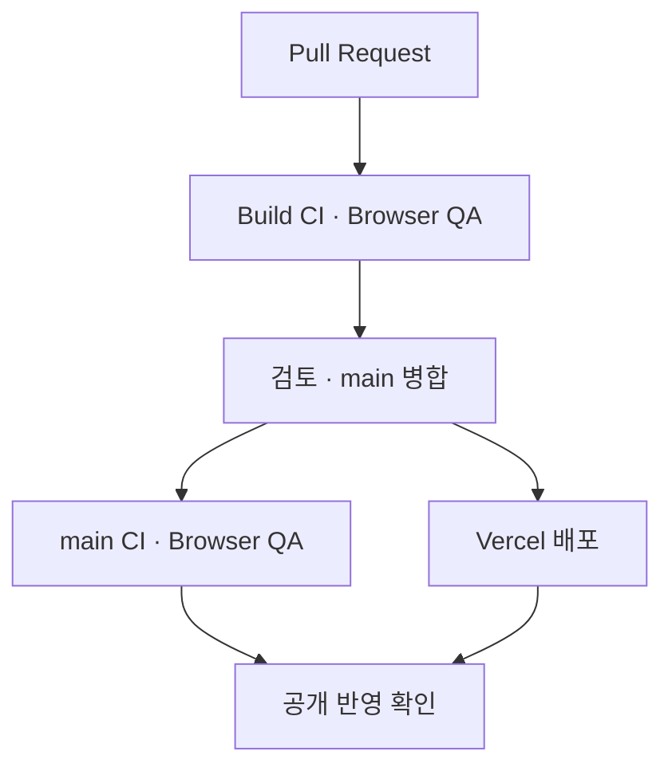

# 포트폴리오 관리 기록

> **현재 최우선 작성 기준 (2026-10-23)**: [팀 프로젝트 중심 포트폴리오 작성 원칙](PORTFOLIO_STORY_POLICY_20261023.md). 이전 기록의 MY/PROJECT 분리·출처 펼치기 UI는 당시 설계였으며, 최신 채용용 서술의 기본 방향이 아닙니다. 개인 기여를 과도하게 축소하지 않고 팀 기술과 협업 경험을 자연스럽게 소개합니다.

[포트폴리오](https://cloud-infra-portfolio.vercel.app/)에는 프로젝트별 역할과 검증 결과를, [저장소 README](../README.md)에는 실행 방법과 소스 구성을 정리했습니다. 이 폴더에는 변경 이유와 확인 결과를 남깁니다.

## 현재 상태 · 2026-10-23

웹 포트폴리오는 PR #31까지 `main` 병합했고, [운영 사이트](https://cloud-infra-portfolio.vercel.app/)는 해당 커밋(`6eb2924`)으로 Vercel Production READY를 확인했습니다. 병합 전 Web CI와 Browser QA 66/66은 통과했습니다. **이는 운영 배포 후 수동 브라우저 확인과는 별개입니다.**

구성은 팀 프로젝트 소개, 주요 기술과 역할, 서비스 아키텍처, 대표 사례를 중심으로 정리했습니다. 실제 링크 없는 출처 펼치기와 반복적인 MY/PROJECT 배지 표기는 줄였습니다.

PDF·PPTX 원본은 별도 산출물로 관리합니다. 2026-10-23 이후 문구 수정에는 [협업 중심 작성 원칙](PORTFOLIO_STORY_POLICY_20261023.md)을 우선 적용합니다.

이하 문서 목록은 당시 작업 기록이므로 과거 PR #26 등은 **이전 이력**입니다.

## 사용자 보류 항목

과거 Git·PR 이력의 전화번호 흔적 정리는 사용자 요청으로 나중에 진행합니다. 현재 소스의 제거와 과거 이력 전체 삭제는 구분합니다. GitHub 보조 문서 보기의 503은 접속 확인 항목이며 사용자가 직접 해야 하는 설정 단계가 아닙니다. 자세한 상태와 이후 작업 순서는 [최종 검토 기록](FINAL_PUBLIC_REVIEW_2026-10-11.md)에 남겼습니다.

## 기록

| 기록 | 내용 |
|---|---|
| [웹·PDF v0.5 독립 감사](TWO_TRACK_V05_FINAL_AUDIT_2026-10-14.md) | 10쪽 PDF/PPTX 재검토, OneReport QA 수정, 로컬 62개 통과와 보호된 Preview 제한 구분 |
| [웹·PDF v0.5 인계](TWO_TRACK_V05_REVIEW_HANDOFF_2026-10-14.md) | v0.5 산출물 체크섬, p4 강조 조정, AWS PoC 표현 정밀화 |
| [웹·PDF 2트랙 독립 감사](TWO_TRACK_REDESIGN_AUDIT_2026-10-14.md) | PDF v0.4 검토본, 근거 바로가기·범위 표기, 로컬 브라우저 검증과 PR 검사 구분 |
| [웹·PDF 2트랙 설계](TWO_TRACK_WEB_PDF_REDESIGN_2026-10-14.md) | 10쪽 요약 자료와 웹 상세의 역할 분리, 버전 이력·보존 기준 |
| [공통 PDF 증빙 표현 정밀화 (2026-10-14)](PORTFOLIO_COMMON_PDF_ACCURACY_POLISH_2026-10-14.md) | p5 단발성 Demo 측정·p10 AWS PoC Smoke 명확화, 원본 Master PPTX 미동기화 경계, 시각 비교 및 링크 검증 |
| [포트폴리오·공개 GitHub 최종 검토](FINAL_PUBLIC_REVIEW_2026-10-11.md) | 채용 담당자 진입 동선, 역할·근거 대조, 소개 문구와 최종 검증 |
| [공개 화면 점검과 설정 완료](PUBLIC_FIRST_IMPRESSION_REVIEW_2026-10-10.md) | 최신 공개 설정, 포크 삭제 근거, README 문구 정리, 검증 범위 |
| [GitHub 소개 화면 정리](GITHUB_PRESENTATION_2026-10-10.md) | 첫 README 개선과 실행 안내 검토 |
| [웹 구성 개선](PORTFOLIO_WEB_REDESIGN_2026-10-10.md) | 홈·네 상세의 구성, PR별 변경·화면·검증·배포 기록 |

기록의 제목 날짜는 해당 작업을 시작한 날짜입니다. 후속 확인일과 코드 기준은 각 기록에 따로 표시합니다.

## 검증과 배포

앱 코드를 변경할 때는 관련 검사와 캡처를 확인한 뒤 병합합니다. 공개 반영은 main 검사 결과와 Vercel 배포 상태를 함께 확인합니다. PR 검사만으로 배포 완료를 판단하지 않습니다.

문서만 바꾼 경우 파일 내용·링크·변경 범위를 확인합니다. 기존 앱 코드의 검사 결과를 새 코드에 대한 검사처럼 기록하지 않습니다.

## 다음 변경 기준

- 새 프로젝트 근거가 생기면 해당 역할·결과·검증 시점을 갱신합니다.
- 특히 Labbit의 실제 VM PTY/SFTP 연동은 새로운 E2E 자료를 확인한 뒤 완료로 표시합니다.
- 공개 URL과 프로젝트 근거 링크가 바뀌면 프로필·README·웹의 연결을 함께 확인합니다.
- 소개에는 필요한 경험을 먼저 두고, 반복되는 조건과 긴 작업 설명은 정리합니다. 중요한 검증 조건은 해당 결과 가까이에 유지합니다.
- 팀 문서·코드·설정과 회사 제출용 PDF/PPTX는 별도 요청 없이 변경하지 않습니다.
